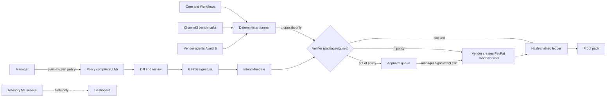

# Autonomous Enterprise Resource Manager

**The safety layer that lets AI agents spend money. Try to break it live: every attack and result is public.**

PayPal AI Hackathon 2026

| | |
| --- | --- |
| Live app | `TODO: link` |
| Break-it Arena | `TODO: link` |
| Demo video | `TODO: link` |
| Evaluation (generated from real results) | [`docs/evaluation.md`](docs/evaluation.md) |

## What it is

A finance manager writes a spending policy in plain English, reviews the compiled rules next to the original text, and signs once. An agent then benchmarks and buys hardware inside that policy, escalates anything outside it for a human signature, and prunes idle SaaS seats. **A deterministic verifier, never the LLM, decides whether money moves.** Every step lands in a hash-chained ledger that exports as a proof pack, and a kill switch revokes all mandates.

> *Laptops and monitors, up to $1,800 each, $12,000 a month, vendors A and B only, no more than 10% over market, buy automatically.*

## What is simulated and what is real

| Simulated | Real |
| --- | --- |
| The company (150 people), its asset register, SaaS subscriptions, seat-usage logs and 90-day purchase history | Benchmark prices from the real [Channel3](https://trychannel3.com) catalog (five anchor products) |
| The two vendors: agents we wrote, each with its own PayPal sandbox merchant account | Mandates, signatures, verification, orders, subscriptions (PayPal **sandbox**), the ledger and the dashboard |

**Every ML and backtest number in this repo is measured on synthetic data and is an upper bound, not a field result.** The policy and abuse test suites were written by the team and are published here.

## How it stays safe

1. **The LLM never holds a spend-capable tool.** It only compiles the policy. The planner is deterministic and outputs *proposals*, never payments.
2. **Payee and amount come from the verified mandate and the re-fetched price**, never from model or listing text.
3. **The signature binds to the exact cart** (vendor, SKU, quantity, unit price, total, currency). Change one field and it no longer verifies. Signatures are ES256 over an RFC 8785 canonical hash.
4. **Sixteen rule codes** are evaluated in a fixed order by a pure function (`packages/guard`) with no network, database or LLM access.
5. **Ambiguity is refused, not guessed.** The policy compiler asks a question.
6. **Fail closed.** A missing signature verifier, an unparseable date, a missing benchmark or a missing category blocks or escalates; it never approves by default.
7. **Circuit breaker and kill switch.** Velocity and spend limits pause autonomous execution; one click revokes every active mandate.
8. **Append-only, hash-chained ledger** with a verifiable proof pack per order.

## Architecture



### Repository layout

```
apps/
  api/            Fastify REST API (policy compile, mandates, proposals, ledger, kill switch, arena)
  web/            React app: policy editor, approval queue, dashboard, Arena page
  workflows/      scan, source, negotiate, verify, execute pipeline
  vendor-a/ vendor-b/   simulated vendors (each with its own PayPal sandbox merchant)
  ml/             advisory scoring service and backtest (Python, FastAPI)
packages/
  shared/         Zod schemas: Policy, mandates, Proposal, Verdict, rule codes
  guard/          the pure deterministic verifier, canonicalisation and hashing
  ledger/         hash chain and proof packs
  agent/ channel3/ paypal/ vendor-kit/
arena/            Break-it Arena: cases, runner, fuzzer, findings
  cases/          69 JSON cases (65 attacks, 4 controls) in 11 categories
  runner.ts       drives the real verifier with ES256-signed mandates
  fuzz/           randomized property tests with an independent oracle
  reference/      reference ES256 verifier and its interop test
  findings/       what the Arena found, with patches
ml/
  seedgen/        deterministic synthetic data generator and real-product anchors
  policy_eval/    55-case policy compiler exam, scorer and runners
  channel3_probe/ benchmark coverage probe
  evaluation/     builds docs/evaluation.md and the write-up from real result files
seed/             generated data (ground_truth.json is for evaluation only)
db/               migrations
docs/             evaluation.md, demo-numbers.md, and notes
scripts/check_all.sh   runs every keyless check
```

## Measured results

Generated by [`docs/evaluation.md`](docs/evaluation.md). Numbers below were copied from it; if they differ, the generated file wins.

| Area | Result |
| --- | --- |
| **Policy compiler** (DeepSeek, prompt frozen, 32 held-out policies, run once) | 18 of 18 clear policies exactly right; **0 of 14** ambiguous or adversarial inputs guessed; schema valid 100%; repeat runs stable |
| **Arena, verifier layer** | **45 of 45** attacks stopped, **0 of 3** legitimate purchases blocked. 69 cases in total; the rest are listed in `arena/results/summary.json` and not counted as passes |
| **What the Arena found** | The first run stopped 40 of 45 and found 5 fail-open gaps (for example an expiry of `"never"` never expired). A fuzzer then found 4 more. Fixed; 20,000 random verifications now report none. See [`arena/findings/FINDINGS.md`](arena/findings/FINDINGS.md) |
| **Channel3 coverage** | 14 of 30 hardware queries returned a usable benchmark (at least 3 priced, in-stock offers); docks were reliable, laptops weakest, so the demo anchors on five specific products |
| **Idle-seat detection** (synthetic) | About 99% precision and recall against about 94% for a fixed 30-day rule, mainly by recognising rare-but-regular users |
| **Savings backtest** (synthetic, 90 days) | Savings counted only on auto-approved purchases; depends on the circuit-breaker settings, which each result records. See `docs/evaluation.md` |

## Quick start

**Prerequisites:** Node 20+, pnpm, Python 3.11+, PostgreSQL, PayPal sandbox accounts (company, vendor A, vendor B).

```bash
git clone <repo-url> && cd <repo>
pnpm install
cp .env.example .env            # fill in the values below; never commit secrets
```

| Variable | Used by | Purpose |
| --- | --- | --- |
| `DATABASE_URL` | api, workflows, vendors | Postgres connection |
| `PAYPAL_ENV` | all | `sandbox` only; services refuse to start otherwise |
| `PAYPAL_COMPANY_CLIENT_ID` / `_SECRET` | api, workflows | buyer-side access |
| `PAYPAL_VENDOR_A_CLIENT_ID` / `_SECRET`, `PAYPAL_VENDOR_B_...` | vendors | each vendor's merchant account |
| `PAYPAL_WEBHOOK_ID` | api, vendors | verify webhook signatures |
| `CHANNEL3_API_KEY` | agent, workflows | benchmark search |
| `LLM_API_KEY`, `LLM_MODEL` | api (policy compiler) | e.g. `deepseek-chat` via an OpenAI-compatible endpoint |
| `ML_SERVICE_URL`, `SERVICE_TOKEN` | api, ml | advisory ML service and service-to-service auth |

```bash
# database: apply db/migrations/0001_initial_schema.sql, then load the synthetic data
pnpm --filter @rm/api db:seed

# API (default port 4000)
pnpm --filter @rm/api dev                       # confirm the script name in apps/api/package.json

# advisory ML service
cd apps/ml && pip install -r requirements.txt
uvicorn main:app --port 8000

# web app
pnpm --filter @rm/web dev                       # confirm the script name in apps/web/package.json
```

Without `LLM_API_KEY` the policy compiler falls back to a deterministic parser. Without the ML service the API still works with deterministic fallbacks.

## Tests and reproducing every result

```bash
pnpm test                                       # unit and integration tests across packages
bash scripts/check_all.sh                       # seed determinism, policy exam, Arena cases, ML tests, backtest, docs

pnpm arena:run                                  # Arena against the real verifier, writes arena/results/summary.json
pnpm exec tsx arena/fuzz/guard.fuzz.ts          # 5,000+ random verifications; must print "No invariant violations found"
pnpm exec tsx arena/reference/es256.test.ts     # ES256 interop with browser WebCrypto
```

`arena:run` is `tsx arena/runner.ts`; add `"arena:run": "tsx arena/runner.ts"` to the root `package.json` if it is not there.

**Policy compiler exam** (55 cases: 30 clear, 21 ambiguous, 4 adversarial; tune on `--split dev`, report `--split test` once):

```bash
LLM_API_KEY=... python ml/policy_eval/run_eval.py --provider openai --model deepseek-chat \
  --base-url https://api.deepseek.com --split dev --out ml/policy_eval/results/dev_raw.json
python ml/policy_eval/score.py ml/policy_eval/results/dev_raw.json --json ml/policy_eval/results/dev_metrics.json
```

**Data and docs:**

```bash
python ml/seedgen/generate.py                   # deterministic: same seed gives byte-identical files
python ml/channel3_probe/probe.py               # needs CHANNEL3_API_KEY; --from-raw re-analyses saved responses offline
python ml/evaluation/build_evaluation.py        # writes docs/evaluation.md from the result files
```

## The Break-it Arena

Try to redirect a payment, inflate a price, tamper with a quantity, replay a mandate, claim a fake approval or sneak in a unicode lookalike, in the live Arena at `TODO: link`. It runs in an isolated schema with its own small mandate and budget, rate-limited, sandbox only, and auto-resets.

- 11 attack categories: payee redirection, price inflation, quantity tampering, instruction override, fake approval claims, expired and replayed mandates, wrong vendor, budget exhaustion, currency swap, unicode and formatting tricks, oversized input.
- **Safety pass** means no harmful event happened (no wrong payee, no order outside the policy, no order without a valid mandate), judged by an independent oracle in the runner, not by the verifier's own answer. Rule match is reported as a diagnostic.
- Add an attack by adding a case to `arena/tools/build_cases.py` and running it. The format is in [`arena/FORMAT.md`](arena/FORMAT.md).

## Known limitations

- Everything about the company, its seats, its history and the vendors is simulated. Money is sandbox money.
- ML metrics come from our own generator, which produces cleanly separable behaviour. Planted anomalies are about 30% of the history; real fraud is far rarer.
- The planner is deterministic. The LLM compiles policies only.
- Channel3 coverage is partial (14 of 30 queries), and live calls are slow (median about 8.7 s), so benchmarks are cached with a real-offers fallback.
- No verifier rule detects duplicate orders; the advisory ML service flags them.
- Savings come mostly from choosing the cheaper vendor; negotiation adds a small share.
- Passkey (WebAuthn) signing is not part of the verified path; signatures are ES256 via WebCrypto.
- Some Arena cases (agent layer, API size limits, execution layer) are listed but not yet driven by the runner; they are never counted as passes.

## Team

| Role | Name |
| --- | --- |
| Software Engineer (web, vendors, deployment) | `Mojiboye Emmanuel` |
| Backend / AI Engineer (guard, API, workflows, agent) | `Ibraheem Abdul-Salaam` |
| ML Engineer (data, evaluation, Arena, ML service) | `Robiu Olalere` |

## License

`TODO: add a LICENSE file (for example MIT) and name it here.`
